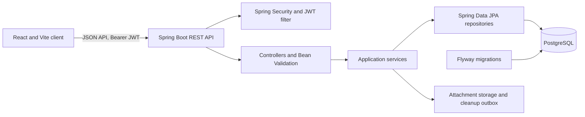

# TaskManagerPro

A full-stack project management application built to demonstrate Java backend engineering with a practical React client. It provides a JWT-secured REST API, PostgreSQL persistence, versioned Flyway migrations, and a Docker-based local stack.

## Project status

- **Deployment:** Not deployed to Render. Staging service URLs, environment settings, database, and persistent attachment storage have not been configured or verified.
- **CI:** A GitHub Actions workflow is present in this working tree for pushes and pull requests targeting `main`. It has not been pushed or run on GitHub.
- **Latest local verification (29 Oct 2026):** The backend non-Docker Maven package command passed with 99 tests and `BUILD SUCCESS`. Frontend tests and build are not verified: local dependency installation failed with Windows `EPERM`, and a safe isolated retry did not complete.
- **Docker integration tests:** Excluded from CI. The application-context integration test uses Testcontainers and requires Docker.

## What it does

- Organizes work into projects with project memberships and role-based permissions.
- Manages issues and tasks with subtasks, assignees, sprints, labels, watchers, and issue links.
- Supports comments, activity history, dashboards, search, time tracking, and CSV exports.
- Provides project custom fields, issue templates, recurring rules, and workflow automations.
- Handles attachment upload and download, with a database-backed cleanup outbox for reliable file deletion.
- Includes account registration, login, user preferences, notifications, and optional email delivery.

## Architecture



The backend separates HTTP controllers, DTOs, application services, repositories, security, and persistence models. The frontend groups API clients, shared state, reusable components, and pages. Docker Compose supports local development; the frontend image uses Nginx.

## Technology

| Area | Technologies |
| --- | --- |
| Backend | Java 21, Spring Boot, Spring MVC, Spring Security, JWT, Bean Validation |
| Persistence | Spring Data JPA, Hibernate, PostgreSQL, Flyway |
| Frontend | React, Vite, Tailwind CSS, Axios, TanStack Query |
| Testing | JUnit 5, Spring test support, Mockito, Testcontainers, Vitest, Testing Library |
| Packaging | Maven Wrapper, npm, Docker, Docker Compose, Nginx |

## Engineering highlights

- Stateless bearer-token authentication. Authorization is enforced in backend services and project-scoped operations; user identity comes from the authenticated security context.
- Request DTO validation and consistent API error responses.
- Versioned SQL migrations. Production startup runs Flyway and Hibernate schema validation; Hibernate is not configured to update the production schema.
- PostgreSQL integration coverage using a disposable Testcontainers database. Migration and attachment cleanup behavior are exercised without relying on a developer database.
- Attachment deletion is queued transactionally and retried by a cleanup worker, keeping database changes coordinated with filesystem cleanup.
- CI runs non-Docker backend tests and packaging alongside frontend tests and a production frontend build.

## Run locally

### Requirements

- JDK 21
- Node.js 22 and npm
- Docker with Docker Compose, for the local PostgreSQL service and integration tests

### Start the database and application

Start the local PostgreSQL container from the repository root:

```shell
docker compose -f docker-compose.db.yml up -d
```

Set private local values in the terminal that will run Docker Compose and the backend. The `dev` profile provides non-sensitive host, port, and database-name defaults only; it requires database credentials and a JWT signing key. Do not add these values to tracked files.

PowerShell:

```powershell
$env:DB_USER = 'local_database_user'
$env:DB_PASS = '<choose-a-private-local-password>'
$env:JWT_SECRET = '<generate-a-private-random-secret-of-at-least-32-bytes>'
$env:SPRING_PROFILES_ACTIVE = 'dev'
.\mvnw.cmd -f backend/pom.xml spring-boot:run
```

macOS/Linux:

```shell
export DB_USER=local_database_user
export DB_PASS='<choose-a-private-local-password>'
export JWT_SECRET='<generate-a-private-random-secret-of-at-least-32-bytes>'
SPRING_PROFILES_ACTIVE=dev bash ./mvnw -f backend/pom.xml spring-boot:run
```

Start the frontend in another terminal:

```shell
cd frontend
npm ci
npm run dev
```

The Vite development server is available at `http://localhost:5173` and proxies `/api` requests to the backend at `http://localhost:8080`.

Alternatively, on Docker Desktop, start the application images after starting PostgreSQL:

```shell
docker compose up --build
```

The Compose frontend is published on port 80 and the backend on port 8080. Run both Compose commands from the same shell where `DB_USER`, `DB_PASS`, and `JWT_SECRET` are set; `DB_NAME` is optional and defaults to `taskdb`. Compose configuration is for local development only; do not reuse its credentials or profile settings in a hosted environment. Stop the database with `docker compose -f docker-compose.db.yml down`; this keeps its named data volume.

### Configuration

The `dev` profile is for local use. It provides non-sensitive local defaults and requires private credentials/signing material:

| Variable | Purpose |
| --- | --- |
| `SPRING_PROFILES_ACTIVE` | Select `dev` locally; select `prod` explicitly for a production-style deployment. |
| `DB_HOST`, `DB_PORT`, `DB_NAME` | PostgreSQL host, port, and database used by the profile. |
| `DB_USER`, `DB_PASS` | Required PostgreSQL credentials for local development and Compose. |
| `JWT_SECRET` | Required JWT signing key. Keep real keys in private environment settings; never commit them. |
| `SPRING_DATASOURCE_URL`, `SPRING_DATASOURCE_USERNAME`, `SPRING_DATASOURCE_PASSWORD` | Standard Spring overrides for the JDBC target and credentials. |
| `APP_CORS_ALLOWED_ORIGINS` | Comma-separated exact browser origins; do not use a wildcard. |
| `VITE_API_URL` | Optional frontend build-time backend base URL, without an `/api` suffix. Leave unset for same-origin/proxy setups. |
| `APP_UPLOAD_DIR` | Attachment storage directory. Use persistent storage for hosted deployments. |
| `PORT` | HTTP port; the app uses the platform-assigned value, with a local default of 8080. |
| `MAIL_ENABLED`, `MAIL_HOST`, `MAIL_PORT`, `MAIL_USERNAME`, `MAIL_PASSWORD`, `MAIL_FROM` | Optional SMTP delivery. Email is disabled by default; keep credentials private. |

Outside `dev` and `test`, configure a strong unique JWT key and an explicit non-local datasource. For Render, activate `SPRING_PROFILES_ACTIVE=prod`; configure the exact frontend origin in `APP_CORS_ALLOWED_ORIGINS`, the staging API base in `VITE_API_URL`, and `APP_UPLOAD_DIR` on a persistent disk. Render URLs and service settings are operator-provided and have not been established here. Never put secret values in the README or source control.

## Tests and builds

Run the complete backend test suite from the repository root. The application-context/Testcontainers test requires Docker and starts an isolated PostgreSQL 16 container.

```shell
bash ./mvnw -B -ntp -f backend/pom.xml test
```

Run the backend CI subset and package build (excludes only the Docker-backed application-context test):

```shell
bash ./mvnw -B -ntp -f backend/pom.xml '-Dtest=!TaskManagerProApplicationTests' package
```

On Windows PowerShell, use `mvnw.cmd` in place of `bash ./mvnw`.

Run frontend checks from `frontend/`:

```shell
npm ci
npm run test:run
npm run build
```

## CI and deployment state

The workflow at `.github/workflows/ci.yml` has two jobs:

1. Backend: Java 21, all non-Docker tests, and Maven `package`.
2. Frontend: Node 22, lockfile-based `npm ci`, Vitest, and the Vite production build.

It uses no production secrets and does not connect to an application database. Because the workflow is currently only in this working tree, GitHub has not run it. Render staging is also not configured or verified; the exact staging frontend/backend origins, database target, and persistent disk remain operator decisions. No deployment is claimed.
